# Retail Customer Value & Retention Analysis

## About the Project

This project analyzes retail transaction data to understand sales performance, product contribution, geographical revenue distribution and customer purchasing behaviour. It uses Python for data cleaning, exploratory data analysis and RFM customer segmentation to identify customer retention opportunities and support business decisions.

## Technologies Used

- Python
- Pandas
- NumPy
- Matplotlib
- Seaborn
- Jupyter Notebook
- Power BI

## Dataset

**Source:** UCI Machine Learning Repository – Online Retail II

The dataset contains retail transaction records with information such as:

- Invoice number
- Product code and description
- Quantity purchased
- Invoice date
- Product price
- Customer ID
- Country

## Project Objectives

- Analyze overall retail sales and revenue performance.
- Identify monthly sales trends and geographical revenue contribution.
- Determine top-performing products.
- Understand new and repeat customer purchasing behaviour.
- Segment customers based on Recency, Frequency and Monetary value.
- Develop business recommendations to improve customer retention and sales performance.

## Project Workflow

1. Data loading and initial inspection.
2. Data cleaning and preprocessing.
3. Exploratory Data Analysis (EDA).
4. Monthly revenue analysis.
5. Country-wise revenue analysis.
6. Product performance analysis.
7. Customer purchasing behaviour analysis.
8. RFM customer segmentation.
9. Business insights and recommendations.
10. Power BI dashboard development.

## Analysis Performed

### Sales Analysis

- Calculated total sales revenue.
- Analyzed monthly revenue trends.
- Identified high and low revenue periods.

### Geographical Analysis

- Analyzed revenue contribution by country.
- Identified leading markets based on revenue.

### Product Analysis

- Identified top-performing products by revenue.
- Examined product-level sales contribution.

### Customer Behaviour Analysis

- Examined customer purchasing patterns.
- Compared new and repeat customers.
- Analyzed customer purchase frequency and monetary contribution.

### RFM Customer Segmentation

Calculated three customer metrics:

- **Recency:** Number of days since the customer's last purchase.
- **Frequency:** Number of distinct invoices or purchases.
- **Monetary:** Total revenue generated by each customer.

Customers were scored from 1 to 5 and grouped into:

- Champions
- Loyal Customers
- At Risk
- Others

## Data Visualizations

### 1. Monthly Revenue Analysis

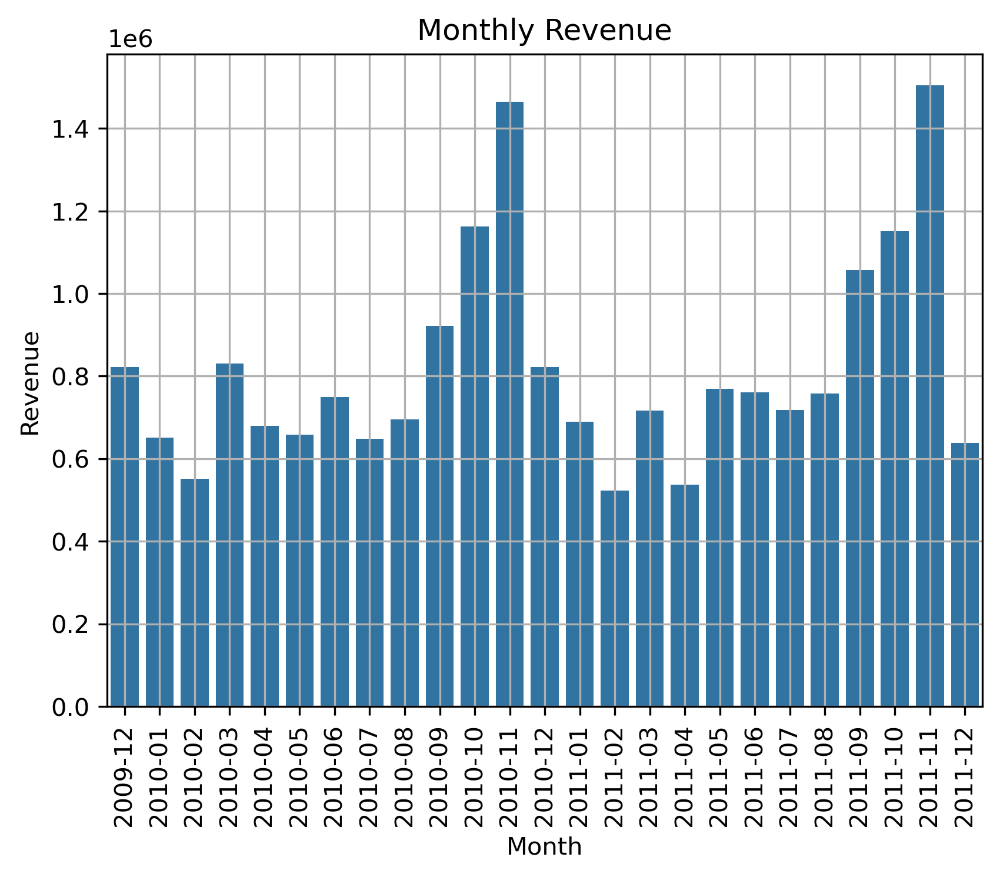

### 2. Country-wise Revenue Analysis

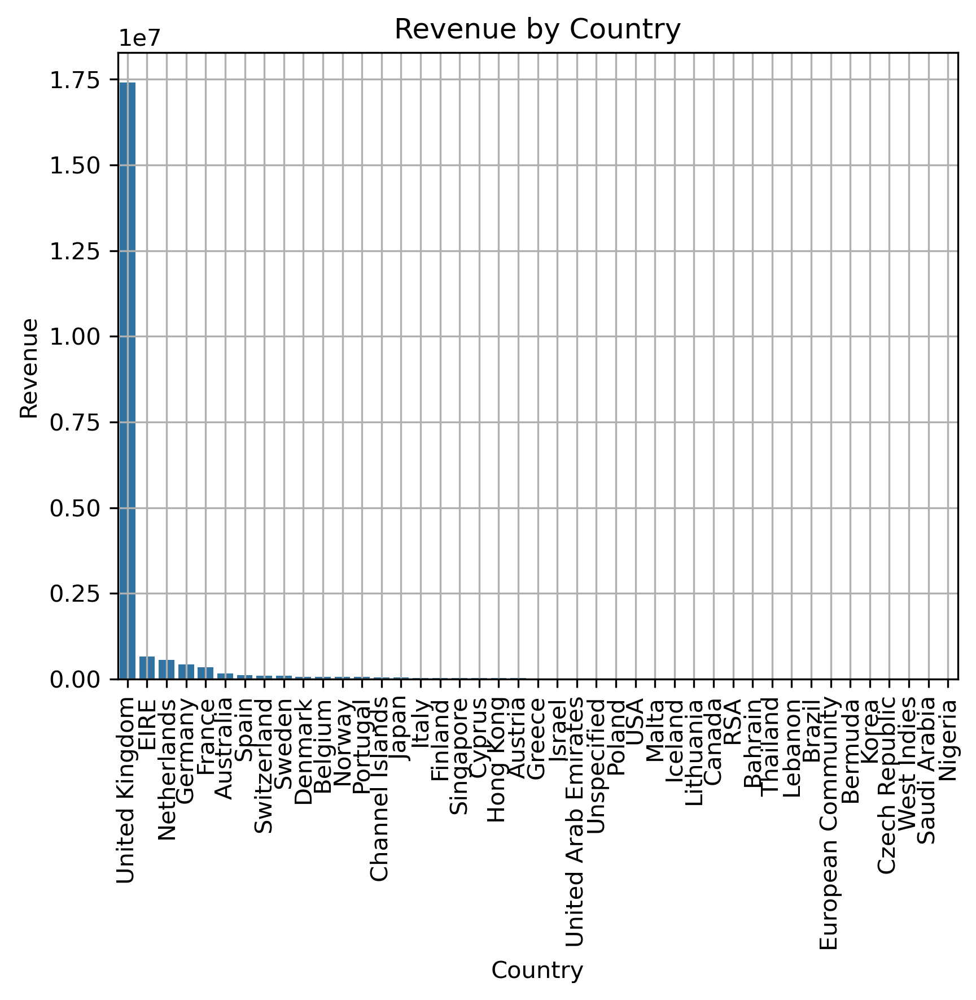

### 3. Product Revenue Analysis

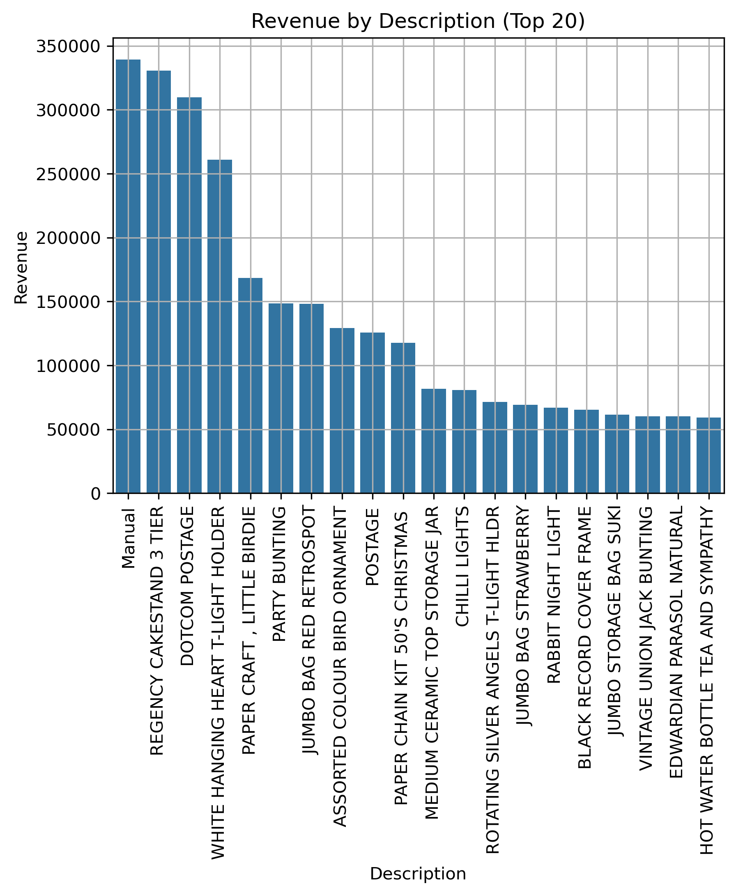

### 4. Customer Distribution

### 5. Top 10 Customers by Revenue

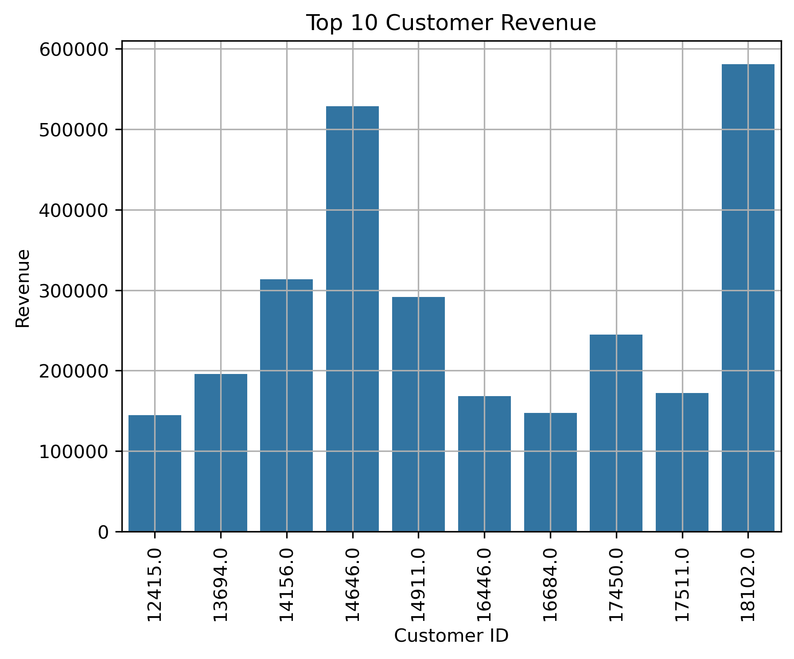

### 6. Top Countries by Transaction Count

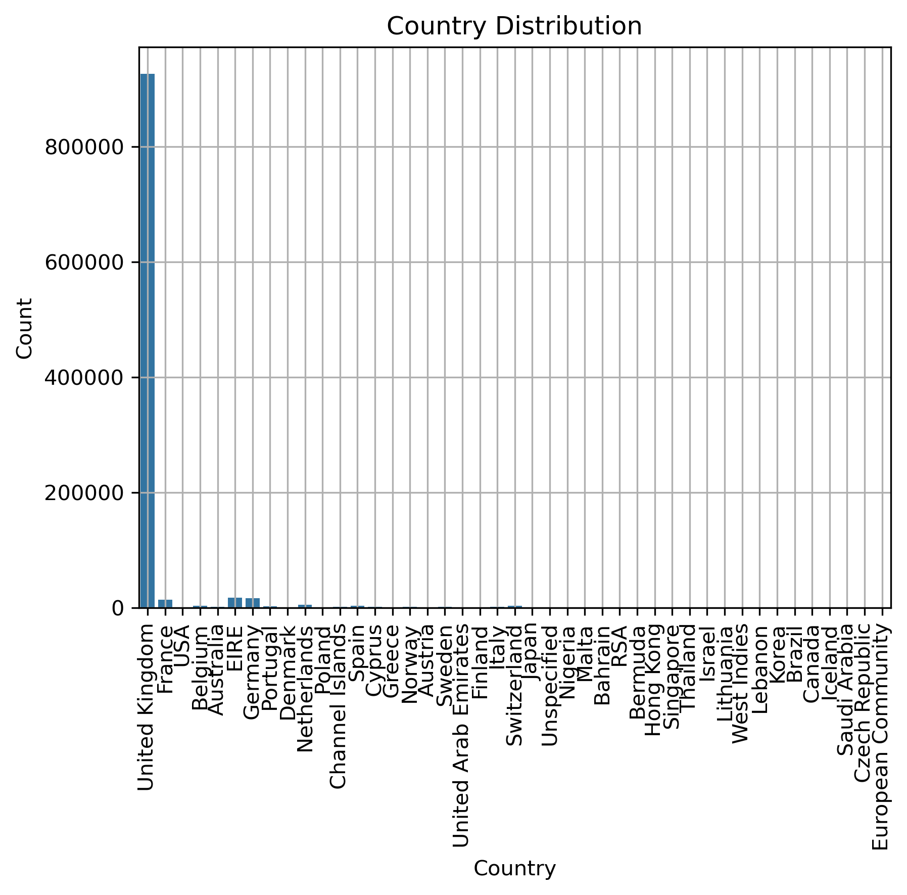

### 7. Revenue Distribution

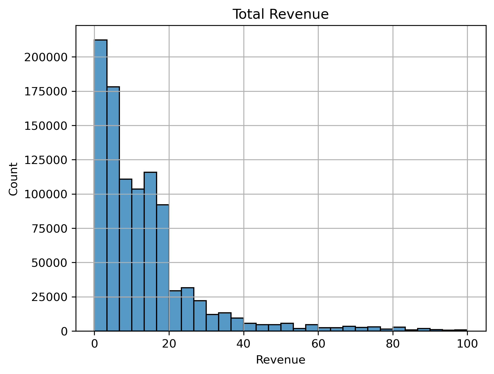

### 8. Price Distribution

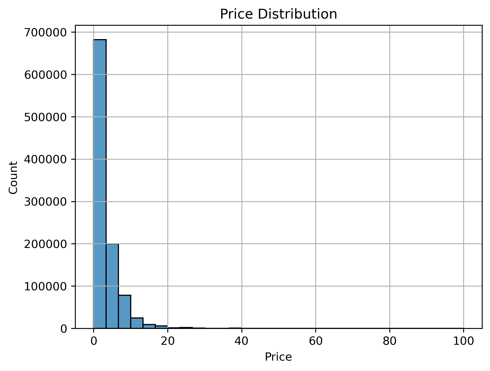

### 9. Price Outlier Analysis

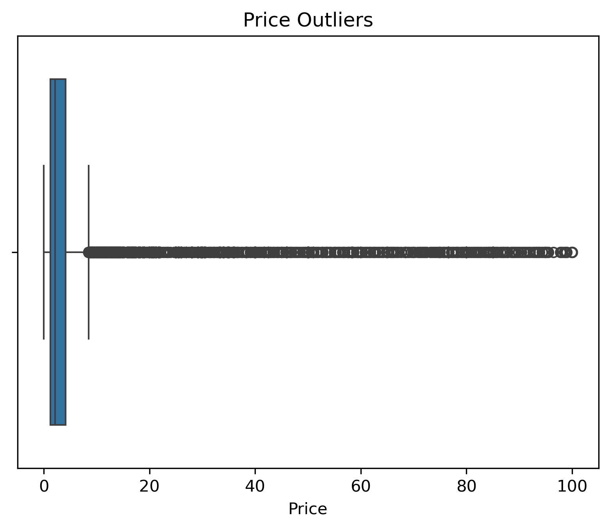

### 10. Quantity Distribution

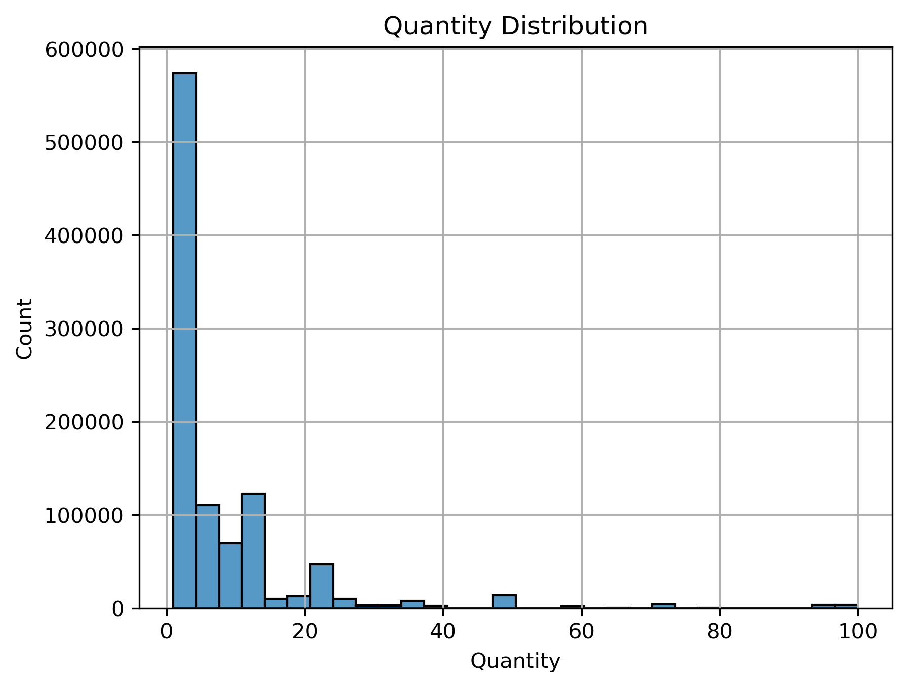

### 11. Quantity Outlier Analysis

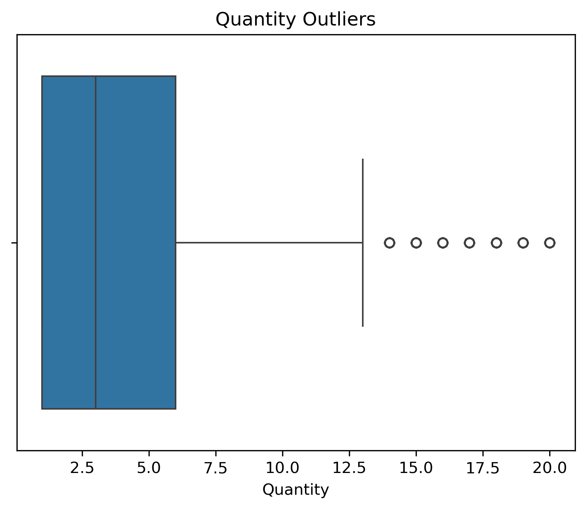

### 12. Quantity vs Price Analysis

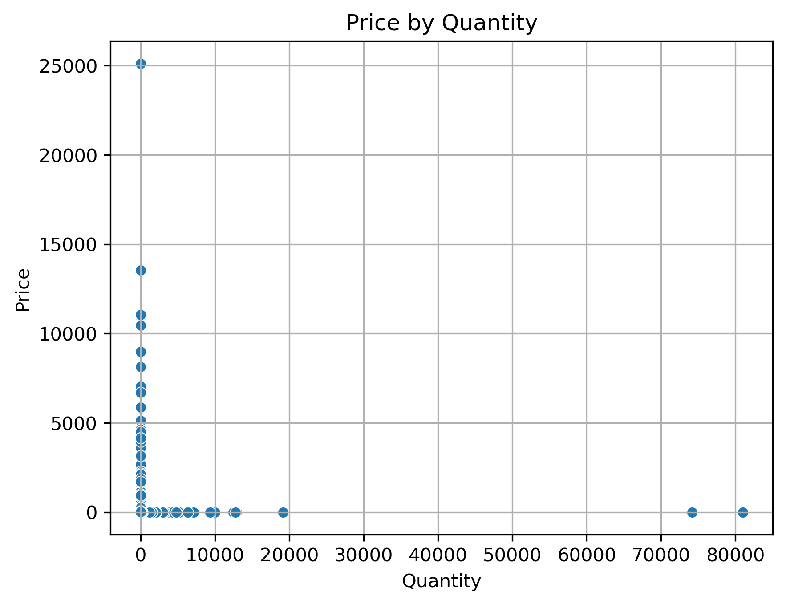

## Power BI Dashboard

The interactive Power BI dashboard presents key retail performance metrics and customer segmentation insights.

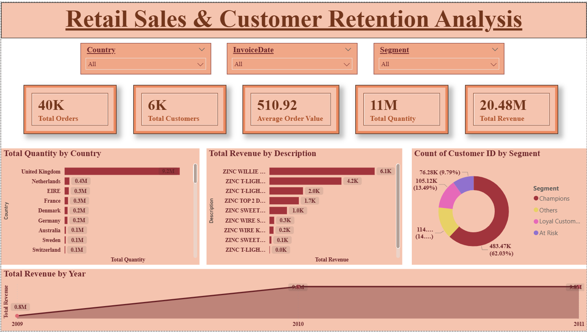

## Business Insights

- Monthly revenue analysis helps identify changes in sales performance and potential seasonal patterns.
- Country-level analysis helps identify the markets contributing most to revenue.
- Product-level analysis highlights products with stronger revenue contributions.
- Customer purchasing analysis helps understand repeat-purchase behaviour.
- RFM segmentation helps distinguish high-value, loyal and potentially inactive customers.

## Business Recommendations

- Introduce loyalty rewards and personalized offers for high-value customers.
- Run targeted re-engagement campaigns for At Risk customers.
- Prioritize stock availability for high-performing products.
- Strengthen customer experience in major revenue-generating markets.
- Encourage repeat purchases through customer retention initiatives.

## Expected Business Value

The analysis provides a structured view of retail sales and customer behaviour. It can help businesses make more informed decisions about inventory planning, market performance, customer retention and sales strategy.

## Tools and Skills Demonstrated

Python, Pandas, NumPy, Data Cleaning, Exploratory Data Analysis, Data Visualization, Customer Segmentation, RFM Analysis, Business Insights and Power BI.